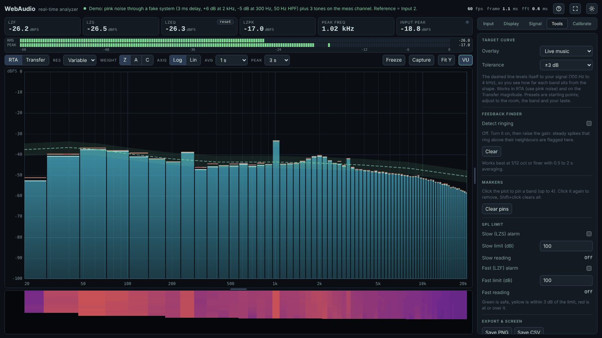
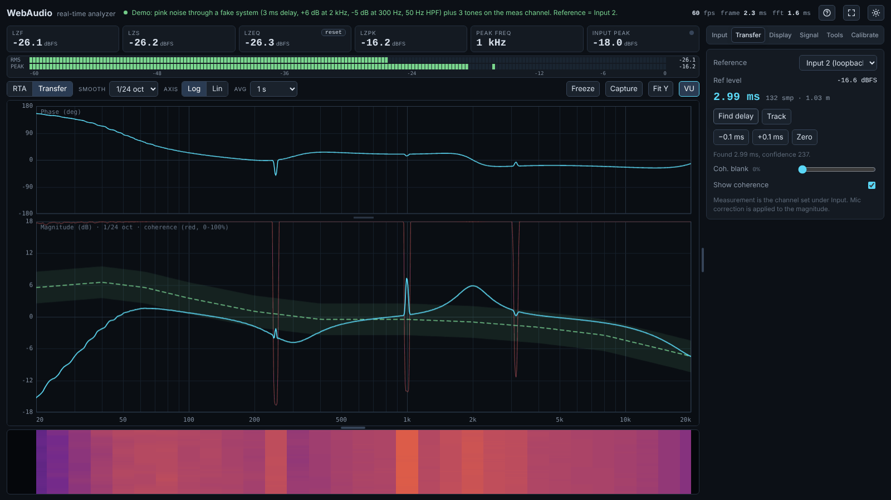
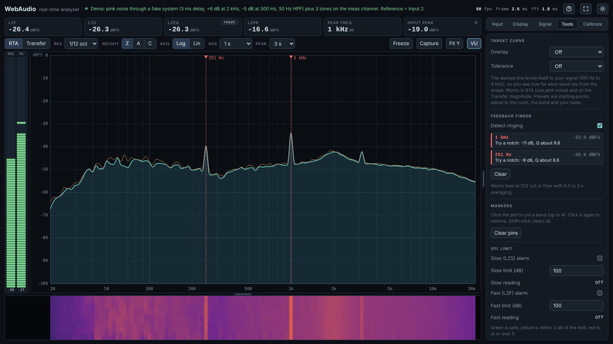
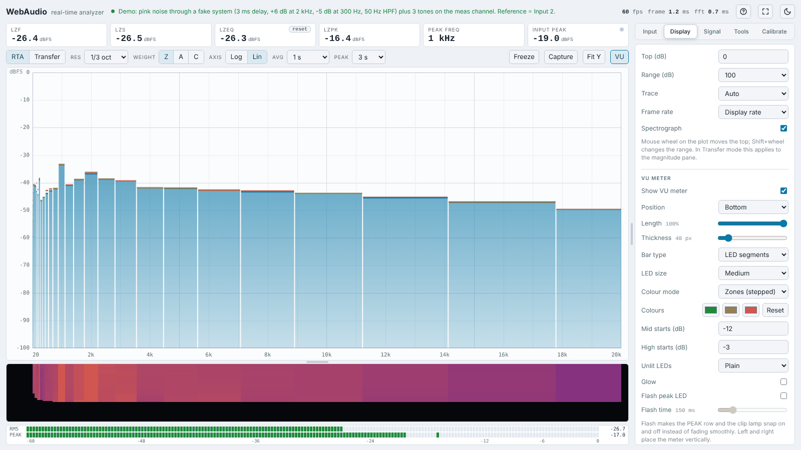
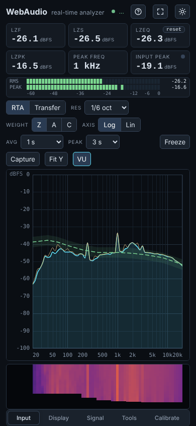

<div align="center">


# WebAudio-RTA

**A real-time audio analyzer and dual-channel transfer function that runs in your browser.**
Built for live sound. Good for installs and system tuning too.


### [▶ Open the app](https://shadowsnow124.github.io/WebAudio-RTA/)

<sub>No install, no sign-up. Works in Chrome or Edge on desktop, tablet and phone.</sub>



</div>

---

## Contents

- [What is it?](#what-is-it)
- [Features](#features)
- [Screenshots](#screenshots)
- [Quick start](#quick-start)
- [Measurement setup](#measurement-setup)
- [User guide](#user-guide)
- [Keyboard & mouse](#keyboard--mouse)
- [How it works](#how-it-works)
- [Requirements & browser support](#requirements--browser-support)
- [Troubleshooting / FAQ](#troubleshooting--faq)
- [Privacy](#privacy)
- [Roadmap](#roadmap)
- [Contributing](#contributing)
- [License](#license)

---

## What is it?

WebAudio-RTA is a free, browser-based measurement tool for audio engineers, a lightweight alternative to tools like Smaart, made for gigs.

- **No install.** Open **[shadowsnow124.github.io/WebAudio-RTA](https://shadowsnow124.github.io/WebAudio-RTA/)** and go. Under the hood it's a single `index.html` with no libraries, no build step and no server code.
- **Live sound first.** Read the room, chase feedback, watch SPL limits and check the PA during a show.
- **Tuning too.** A dual-channel transfer function with phase, coherence and delay finding for system alignment and installs.
- **Private.** Audio is analyzed on your device. Nothing is recorded or uploaded.

---

## Features

### RTA (spectrum)
- Fractional-octave bands: **1/1, 1/3, 1/6, 1/12, 1/24, 1/48 octave**
- **Variable resolution:** 1/1 oct in the lows narrowing smoothly to 1/24 oct in the highs. The bass stays steady and the highs show detail.
- **Log or linear** frequency axis
- **Z / A / C** weighting
- Averaging 125 ms to 8 s, or infinite; peak hold 1 s / 3 s / 10 s / hold
- Bars or line trace, plus a scrolling **spectrograph**
- **Freeze** and **Capture** traces to compare against the live one
- **Markers:** pin up to 4 bands and read their levels

### Transfer function (dual channel)
- **Magnitude, phase and coherence**, with fractional-octave smoothing
- Reference from **input 2 (loopback)**, input 1, or the **internal generator**
- **Delay finder** (one shot or tracking) showing ms, samples and metres, with ±0.1 ms nudge
- Coherence blanking to hide unreliable data

### Target curves
- Presets: **Flat, Live music, Rock / loud live, Club / EDM / hip-hop, Speech / corporate, Studio / hi-fi room, Cinema X-curve**
- Slopes: -1.5 / -3 / -4.5 dB/oct
- **Custom curve** from a text file
- Optional **±1.5 / ±3 / ±6 dB tolerance band**
- Auto-levels to your signal; shown on the RTA *and* the transfer magnitude

### Live-show tools
- **Feedback finder:** flags ringing frequencies and suggests a notch (depth and Q)
- **SPL limit alarms:** separate Slow and Fast limits; tiles go green / yellow / red
- **Meters:** Fast, Slow, Leq, peak, peak frequency (with musical note), input peak with clip lamp
- **VU meter** (dBFS RMS + peak hold): top, above the plot, bottom, or vertical left / right; LED or continuous; custom colours and thresholds; glow; peak flash

### Calibration & setup
- **SPL calibration** with a 94 dB (or any level) calibrator, or a manual offset
- **Mic correction file** (frequency / dB pairs)
- **Signal generator:** pink noise, white noise, sine (20 Hz to 20 kHz, -70 to 0 dBFS)
- **Settings file:** export everything, including the mic and target curves, to JSON and import it on another computer. Calibration is only applied after you confirm.

### Everything else
- Export **PNG** (graph) and **CSV** (data)
- Dark and light themes, fullscreen, keep-screen-on
- Resizable panels; works on desktop, tablet and phone
- Hover tips on every control (can be turned off)
- **Demo signal**, so you can try it all without a mic

---

## Screenshots

<table>
<tr>
<td width="50%"><br><sub><b>Transfer function:</b> phase, magnitude and coherence after Find delay, with a Live target.</sub></td>
<td width="50%"><br><sub><b>Feedback finder:</b> ringing at 251 Hz and 1 kHz flagged, with notch suggestions. Vertical VU on the left.</sub></td>
</tr>
<tr>
<td width="50%"><br><sub><b>Light theme:</b> 1/3-octave bars on a linear axis, VU meter settings.</sub></td>
<td width="50%" align="center"><br><sub><b>Phone layout.</b></sub></td>
</tr>
</table>

---

## Quick start

### 1. Use it online (easiest)
Open **[https://shadowsnow124.github.io/WebAudio-RTA/](https://shadowsnow124.github.io/WebAudio-RTA/)** in Chrome or Edge, click **Start microphone** and allow access.

It's served over HTTPS, so the mic works straight away. Nothing to download.

### 2. Run it locally
Handy for working on the code, or as a backup when there's no internet at the venue.
```bash
git clone https://github.com/shadowsnow124/WebAudio-RTA.git
cd WebAudio-RTA
python -m http.server 8000
```
Open **http://localhost:8000** in Chrome or Edge.

> **Why a local server?** Browsers only give websites the microphone on **HTTPS** or **localhost**. Double-clicking `index.html` opens it, and the demo signal works, but the mic may be blocked.

### 3. Host your own copy
Fork the repo and turn on GitHub Pages (**Settings → Pages → Deploy from branch → `main` / root**). Your copy appears at `https://<your-username>.github.io/WebAudio-RTA/`. Any HTTPS static host works too (Netlify, Cloudflare Pages, …): just upload `index.html` and the `img/` folder.

### First run
1. Click **Start microphone** and allow access, or click **Try demo signal**.
2. **Input** tab: choose your audio interface and the channel your measurement mic is on.
3. **Calibrate** tab: put a calibrator on the mic and press **Calibrate** to read real dB SPL.

---

## Measurement setup

### RTA only
```
 Measurement mic ──► Interface input 1 ──► Computer (browser)
```
Play pink noise (from the built-in generator or your console) and look at the spectrum.

### Transfer function
```
                ┌──────────────► Interface input 2  (reference / loopback)
 Console out ───┤
                └──► Processor ──► Amp ──► Speaker ~~~~► Mic ──► Interface input 1  (measurement)
```
1. Send the same signal to the system and, by a loopback cable, to **input 2**.
2. Measurement mic on **input 1**.
3. Switch to **Transfer**, press **Find delay** (`D`), then read magnitude, phase and coherence.

You can also use the **internal generator** as the reference, with no loopback cable.

**Tips**
- Use a measurement mic (flat, omni). A vocal mic will lie to you.
- Turn off "enhancements", noise suppression and auto gain for the interface in your OS. The app already asks the browser to turn them off.
- Leave headroom: if the clip lamp lights, turn the input gain down.

---

## User guide

<details>
<summary><b>SPL calibration</b></summary>

1. Go to **Calibrate**, enter your calibrator level (usually 94 dB SPL at 1 kHz).
2. Put the calibrator on the mic and press **Calibrate**. It measures for 3 seconds.
3. Readings switch from dBFS to **dB SPL**. **Back to dBFS** removes it.

Calibration belongs to one mic + interface + gain setting. Re-calibrate if you change any of them.
</details>

<details>
<summary><b>Mic correction file</b></summary>

A plain text file with frequency and dB columns (space, comma, tab or semicolon separated):
```
20    1.2
100   0.3
1000  0.0
10000 -0.8
20000 -2.5
```
It corrects the spectrum and transfer magnitude. SPL meters are not affected.
</details>

<details>
<summary><b>Target curves</b></summary>

**Tools → Target curve.** Pick a preset, slope or custom file, and optionally a tolerance band.
The dashed line moves up and down to match your signal between 100 Hz and 4 kHz, so you only judge the *shape*.

| Preset | Shape (compared with 1 kHz) |
|---|---|
| Live music | about +6 dB lows, flat mids, gentle roll-off to about -6 dB at 16 kHz |
| Rock / loud live | about +10 dB at 40 Hz, more top roll-off |
| Club / EDM / hip-hop | about +12 dB sub around 35 to 50 Hz |
| Speech / corporate | lows cut below 100 Hz, small presence lift at 2 to 3 kHz |
| Studio / hi-fi room | gentle tilt, +5 dB at 20 Hz to -6 dB at 20 kHz |
| Cinema X-curve | flat to 2 kHz, then rolls off (ISO 2969 shape) |

Presets are starting points, not rules. Custom curves use the same file format as mic correction.
</details>

<details>
<summary><b>Feedback finder</b></summary>

**Tools → Feedback finder → Detect ringing.** Set **Res** to 1/12 oct or finer (or Variable) and averaging to 0.5 to 2 s, then bring the gain up slowly. Steady peaks that ring above their neighbours are flagged on the graph and listed with a suggested notch depth and Q.
</details>

<details>
<summary><b>SPL limit alarms</b></summary>

**Tools → SPL limit.** Separate alarms for the **Slow** and **Fast** readings, each with its own limit. Tiles turn **green** (safe), **yellow** (within 3 dB) or **red** (at or over). They use the selected weighting (Z/A/C).
</details>

<details>
<summary><b>VU meter</b></summary>

**Display → VU meter.** Position (top / above plot / bottom / left / right), length, thickness, LED or continuous bar, LED size, colour mode (zones / fade / single), custom colours, mid/high thresholds, unlit LED style, glow and peak flash.
</details>

<details>
<summary><b>Settings file (move your setup to another computer)</b></summary>

**Tools → Settings file → Export** saves every setting, plus your mic correction and custom target curve, to a `.json` file. **Import** loads it. If the file contains an SPL calibration, you're asked before it's applied. **Defaults** resets everything.

`Setting.json` in this repo is an example export.
</details>

---

## Keyboard & mouse

| Key | Action |
|---|---|
| `Space` | Freeze / unfreeze |
| `C` | Capture trace |
| `R` | Reset meters and averages |
| `T` | Toggle RTA / Transfer |
| `X` | Toggle log / linear axis |
| `D` | Find delay (Transfer) |
| `P` | Clear markers |
| `F` | Fullscreen |
| `L` | Light / dark theme |

| Mouse | Action |
|---|---|
| Wheel on plot | Move the top of the scale |
| Shift + wheel | Change the dB range |
| Click on plot | Pin / unpin a marker |
| Shift + click | Clear all markers |
| Drag the dividers | Resize side panel, spectrograph, phase / magnitude panes |

---

## How it works

Everything runs in the browser on the [Web Audio API](https://developer.mozilla.org/docs/Web/API/Web_Audio_API). An **AudioWorklet** captures raw samples from up to two inputs into a ring buffer, and all the DSP is plain JavaScript.

- **RTA:** Hann-windowed FFTs at several sizes (512 to 32768 points, 65536 at high sample rates). Each band uses the smallest FFT that still gives it at least 8 bins, so low bands get the frequency resolution they need without slowing down the highs. Band power is summed from the bins, then smoothed with exponential averaging.
- **Weighting:** A and C weighting are IIR filters built from the IEC 61672 pole frequencies (bilinear transform), normalised to 0 dB at 1 kHz.
- **SPL meters:** Fast (125 ms) and Slow (1 s) exponential time weighting, Leq as a running energy average, and peak.
- **Transfer function:** the H1 estimator (Gxy / Gxx) with **multi-time-window** FFTs: each frequency uses the shortest window that still gives about 64 cycles of resolution. It's computed on a 96-points-per-octave grid, then smoothed. Coherence is computed from the same cross and auto spectra.
- **Delay finder:** FFT cross-correlation of the reference and measurement over a 65536-sample window.

No frameworks, no dependencies, no network calls.

---

## Requirements & browser support

| | |
|---|---|
| **Best** | Recent **Chrome** or **Edge** on desktop |
| **Should work** | Other modern browsers with AudioWorklet support (less tested) |
| **Needs** | HTTPS or localhost for microphone access (the online version is HTTPS) |
| **Inputs** | The first two channels of an interface are used (measurement + reference) |
| **Accuracy** | Depends on your mic and interface; use a measurement mic and calibrate for SPL work |

---

## Troubleshooting / FAQ

**The mic won't start / "Microphone access needs HTTPS or localhost".**
Use the [online version](https://shadowsnow124.github.io/WebAudio-RTA/), or serve the folder with `python -m http.server` and open `http://localhost:8000`. Also check that the browser has mic permission (the lock / site-settings icon in the address bar). The demo signal works anywhere.

**The online version still shows an old version after an update.**
GitHub Pages can take a minute or two to update after a push. Then hard-refresh with **Ctrl+F5**.

**I only see one input channel.**
Some interfaces show up as stereo only in certain modes. Check the OS sound settings for the interface's channel count. The browser asks for 2 channels.

**The spectrum looks wrong in the lows / is jumping around.**
Increase **Avg**, or use **Variable** resolution, which uses wide bands at low frequencies.

**Phase looks like a barcode in Transfer mode.**
The reference and measurement aren't time-aligned. Press **Find delay** (`D`) with pink noise playing.

**My local changes don't show.**
Hard-refresh the tab with **Ctrl+F5**. An open tab keeps the old version.

**Readings are different from my SPL meter.**
Calibrate first, match the weighting (A/C/Z) and time weighting (Fast/Slow), and remember that the mic correction doesn't change the SPL meters.

---

## Privacy

All audio processing happens locally in your browser. Nothing is recorded, stored or sent anywhere. Settings are saved in your browser's local storage, and in a JSON file only if you export one.

---

## Roadmap

Ideas for future versions:

- [ ] Offline / installable app (PWA)
- [ ] SPL logging over time: LAeq 1/5/15/60 min, LCpeak, history graph, CSV/PDF report
- [ ] Save, name and load captured traces
- [ ] Average multiple mic positions
- [ ] Trace math (A − B, average, offset, invert)
- [ ] Sub / main alignment helper
- [ ] EQ suggestions toward the target curve
- [ ] Impulse response view, log sweep, RT60
- [ ] Big-number SPL view for FOH, night (red) theme
- [ ] Input health warnings (clipping, low signal, noise floor)
- [ ] Accuracy verification against reference tools and IEC 61672 / 61260

---

## Contributing

Issues and pull requests are welcome.

1. Fork the repo and create a branch.
2. The whole app is `index.html`. Edit it, run it locally (`python -m http.server`) and test in Chrome/Edge with both the **demo signal** and a real mic.
3. Keep it dependency-free and single-file.
4. Open a pull request describing what changed and how you tested it.

Bug reports are most useful with your browser, OS, audio interface and a screenshot.

---

## License

[GNU General Public License v3.0](LICENSE): you can use, study, share and modify it. If you distribute a modified version, it must also be open source under the GPL.

---

<div align="center">
<sub><a href="https://shadowsnow124.github.io/WebAudio-RTA/">Open the app</a> · Made for live sound by <a href="https://github.com/shadowsnow124">shadowsnow124</a>. Measurement tools help your ears; they don't replace them.</sub>
</div>
